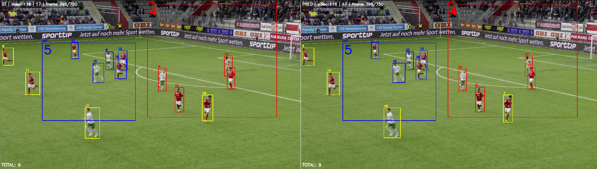
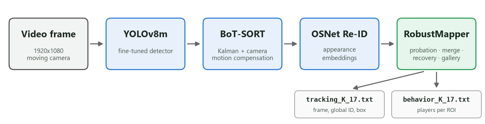
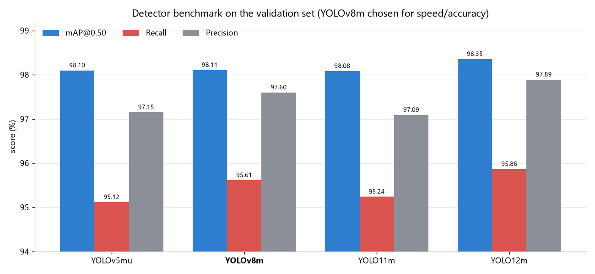
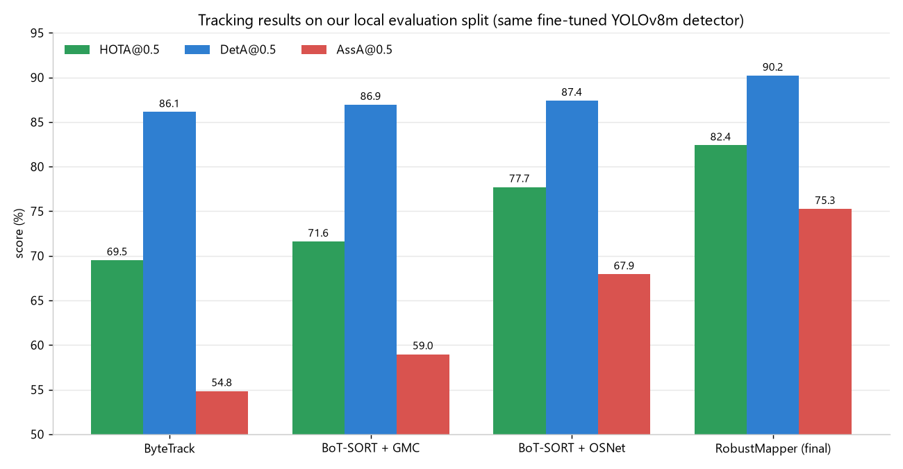

# Soccer Player Tracking & Behavior Analysis

**Artificial Vision contest · Group 17 · MSc in Computer Engineering, University of Salerno (A.Y. 2025/2026)**

A computer vision pipeline that detects every player, goalkeeper and referee in broadcast football video, keeps a **persistent identity** for each of them while the camera pans and zooms, and counts how many players stand inside two regions of the pitch in every frame.


<sub>Left: ground truth. Right: our output. Boxes are coloured by region (blue = ROI 1, red = ROI 2, yellow = outside). Both sides count 5 and 4 players.</sub>

| HOTA@0.5 | DetA@0.5 | AssA@0.5 | nMAE | **PTBS** |
|:---:|:---:|:---:|:---:|:---:|
| 0.8239 | 0.9021 | 0.7526 | 0.9834 | **1.8073** / 2 |

---

## Table of contents

- [The task](#the-task)
- [Pipeline overview](#pipeline-overview)
- [1. Data preparation](#1-data-preparation)
- [2. Detection](#2-detection)
- [3. Multi-object tracking](#3-multi-object-tracking)
- [4. Behavior analysis](#4-behavior-analysis)
- [Evaluation tools](#evaluation-tools)
- [Getting started](#getting-started)
- [Repository structure](#repository-structure)
- [Limitations and ideas](#limitations-and-ideas)
- [Team](#team)

---

## The task

The contest is built on the [SoccerNet](https://www.soccer-net.org/) tracking data. The test set has 5 clips, 30 seconds each, at 1920×1080 from a moving broadcast camera. For each clip the system has to produce two files:

| File | One line per | Format |
|---|---|---|
| `tracking_K_17.txt` | detected person per frame | `frame_id,object_id,x,y,w,h` |
| `behavior_K_17.txt` | ROI per frame | `frame_id,region_id,n_players` |

**Player tracking** is scored with **HOTA@0.5**, which splits into **DetA** (did you find the players?) and **AssA** (did you keep the right ID on them over time?).

**Behavior analysis**: each clip comes with two rectangular ROIs in normalized coordinates. A player is inside a ROI if the **centre of the bottom edge** of their box falls inside it. The error is the MAE over all frames and both regions, normalized as:

$$nMAE = \frac{10 - \min(10,\ MAE)}{10}$$

**Final score:** $PTBS = HOTA_{0.5} + nMAE$ (maximum 2).

---

## Pipeline overview



1. **Detect**: a YOLOv8m fine-tuned on SoccerNet finds every person on the pitch.
2. **Track**: BoT-SORT with global camera-motion compensation links boxes from one frame to the next.
3. **Describe**: an OSNet Re-ID network turns each player crop into an appearance embedding.
4. **Remember**: our **RobustMapper** maps BoT-SORT's short-lived IDs to persistent global IDs. It merges fragmented tracks and recovers players who left the frame.
5. **Count**: each tracked box is assigned to a ROI using its base-center point.

Everything for inference is in [`src/Tracker/Yolo12m/inference.py`](src/Tracker/Yolo12m/inference.py).

---

## 1. Data preparation

| Step | Script | What it does |
|---|---|---|
| Download | [`src/Dataset/download_dataset.py`](src/Dataset/download_dataset.py) | Fetches `tracking-2023` (train / test / challenge) via the SoccerNet API |
| Clean GT | [`src/Dataset/clean_gt.py`](src/Dataset/clean_gt.py) | Keeps only `player`, `goalkeeper`, `referee` (drops the ball) and maps them to one detector class, keeping track IDs for evaluation |
| Convert | [`src/Dataset/convert_to_yolo.py`](src/Dataset/convert_to_yolo.py) | Converts to YOLO format and keeps 1 frame out of `TRAIN_SUBSAMPLE_RATE`, which was **3** for the final detector. At 25 fps consecutive frames are nearly identical, so this cuts the training set by 66% at little cost in visual variety |
| Split | [`src/Dataset/create_splits.py`](src/Dataset/create_splits.py) | Deterministic **80/20 split by sequence** through manifest files, so no clip appears in both train and validation |
| ROI GT | [`src/Dataset/forNMAE/`](src/Dataset/forNMAE) | Generates random, non-overlapping ROI pairs and the matching behavior ground truth, so nMAE can be measured locally |

---

## 2. Detection

Tracking-by-detection can't recover a player the detector never saw, so we started from the detector. Off-the-shelf COCO models struggled with small, far-away players and with motion blur from fast pans, so we fine-tuned on SoccerNet.

**Benchmark of four YOLO families** (validation set):



YOLO12m scored highest, but only by about 0.25 points of recall over YOLOv8m at a noticeably higher compute cost. **We picked YOLOv8m** as the better trade-off.

**Training choices** ([`src/Detector/YOLO/freezing_train.py`](src/Detector/YOLO/freezing_train.py)):

- **Custom fitness = mAP@50 only.** The contest scores at IoU 0.5, so we overrode Ultralytics' default fitness (which is weighted toward mAP@50-95) to pick `best.pt` on mAP@50. This favours a robust detector over pixel-perfect boxes that the metric ignores.
- **Backbone freezing** (first 10 layers): keeps the generic features learned on large datasets and adapts only the head to pitches and kits.
- **AdamW**, `lr0 = 5e-4`, 50 epochs, `imgsz = 1280`, scale augmentation for camera zoom.
- **Tried and dropped:** tripling the classification loss gain (`cls 0.5 → 1.5`) to push recall did not improve results.

---

## 3. Multi-object tracking

We changed the tracker in steps, each time looking at where AssA was failing:



| Tracker | HOTA | DetA | AssA | What we learned |
|---|---:|---:|---:|---|
| ByteTrack | 69.51 | 86.12 | 54.84 | IoU + linear Kalman filter. Camera pans look like players accelerating, so tracks break |
| BoT-SORT + GMC | 71.60 | 86.94 | 58.97 | Aligning frames stabilises the Kalman prediction, but IDs still swap when teammates cross |
| BoT-SORT + OSNet Re-ID | 77.71 | 87.40 | 67.93 | Appearance helps a lot, but players who are off-screen for a long time come back with new IDs |
| **RobustMapper (final)** | **82.39** | **90.21** | **75.26** | Global ID memory with probation, merging and recovery |

AssA improved by **+20 points** over the baseline. Most of the overall gain came from keeping identities, not from finding more players.

### Re-ID features

`ReIDExtractor` crops each detection, resizes it to 128×256 and runs **OSNet x1.0** from [sportsreid](sportsreid/README.md), trained on SoccerNet Re-ID. Before using it, we checked that the test split was not used in its training, dropped the classification head (we only need the embeddings) and confirmed it expects RGB input. Output vectors are L2-normalized.

We also tried a **ViT-B/16** Re-ID model. It was slower and scored worse on the contest metrics, so OSNet stayed.

### RobustMapper

BoT-SORT handles short-term motion well, but each of its IDs knows nothing about earlier IDs. RobustMapper adds a layer of **global identities** on top, with a small state machine:

| State | Meaning |
|---|---|
| **Probation** | A new BoT-SORT ID is not trusted right away. It has to survive `PROBATION_FRAMES = 8` frames, so short-lived false positives never become players. |
| **Locked** | Confirmed player. Its appearance is stored in a **gallery of up to 50 poses**, not an EMA: a player from the back, the side, or half-occluded can look like three different people, and a gallery keeps all three. New poses are added only if they are high confidence (`conf > 0.6`) and different enough from what is already stored. |
| **Merge** | If a probation track looks like a recently lost locked track (cosine sim > `0.85`, or > `0.70` once probation ends) and is in a plausible position, it takes back the old ID. This fixes BoT-SORT splitting one player into two IDs. |
| **Recovery** | Unmatched detections are compared with **dormant** tracks (unseen for up to 900 frames) using appearance (sim > `0.75`) **and** a distance gate that grows with the time elapsed. Locked tracks stay in memory for `MAX_TIME_LOST = 1500` frames, while probation tracks are dropped after 60. |

Each frame is processed in five phases: temporal continuity → merge of probation tracks → recovery of lost IDs → creation of new tracks → garbage collection. A global ID is never assigned to two boxes in the same frame. Only the top `MAX_ENTITIES = 28` detections by confidence are kept.

---

## 4. Behavior analysis

A bounding box is a perspective projection, and its centre sits on the player's torso. We use the **base center** instead, which is where the feet touch the ground:

$$P_{base} = \left(x_{min} + \frac{w}{2},\ y_{min} + h\right)$$

ROI coordinates are scaled from [0, 1] to 1920×1080 pixels, and each player is tested for inclusion in every frame. Because the counts come from stable tracks rather than raw detections, they don't flicker from frame to frame.

The local test set has no ROIs, so [`src/Dataset/forNMAE/2_generate_roi.py`](src/Dataset/forNMAE/2_generate_roi.py) creates them. It places a random first ROI, then makes up to 100 attempts to place a second one that does not overlap it, and uses a fixed safe region if all attempts fail. This way the evaluation never stops for missing annotations.

---

## Evaluation tools

[`SIMULATOR/simulator.py`](SIMULATOR/simulator.py) reproduces the contest scoring locally:

- builds the folder structure TrackEval expects and computes **HOTA@0.5** with the official [TrackEval](https://github.com/JonathonLuiten/TrackEval) library,
- computes **MAE / nMAE** from the behavior files ([`evaluation_helper.py`](SIMULATOR/evaluation_helper.py)),
- prints the final **PTBS**,
- optionally renders a **side-by-side GT vs. prediction video** with ROI-coloured boxes and live counters, like the image at the top of this page.

---

## Getting started

### 1. Environment

```bash
conda env create -f conda/build/requirements.yaml
```

```bash
conda activate soccer_tracking
```

Python 3.10, PyTorch ≥ 2.3 with CUDA 12.1, Ultralytics, TrackEval, SoccerNet. The `torchreid` package comes from the bundled [`sportsreid/`](sportsreid) folder:

```bash
pip install -e sportsreid
```

### 2. Data and weights

```bash
python src/Dataset/download_dataset.py
```

Model weights are not tracked in git (`*.pt`, `*.pth` are ignored). Place them as follows:

| File | What it is |
|---|---|
| `models/bestyolo8.pt` | our fine-tuned YOLOv8m detector |
| `models/re-ids/osnet_x1_0.pt` | OSNet x1.0 Re-ID checkpoint from the [sportsreid model zoo](sportsreid/README.md) |

### 3. Run inference

Set `base_path` in [`inference.py`](src/Tracker/Yolo12m/inference.py) to the folder with the test sequences (`<seq>/img1/*.jpg` and optional `<seq>/roi.json`), then run:

```bash
python src/Tracker/Yolo12m/inference.py
```

Results are written to `out/tracker_results/contest_outputs_gr17/`.

### 4. Evaluate

Set `predictions_root` at the bottom of [`simulator.py`](SIMULATOR/simulator.py), then run:

```bash
python SIMULATOR/simulator.py
```

### Hardware

Training ran on RunPod (NVIDIA A5000) and on local RTX 3060 / RTX 5070 GPUs.

---

## Repository structure

```
├── config.py                  # central paths (dataset, models, outputs)
├── conda/                     # environment build / run scripts
├── src/
│   ├── Dataset/               # download, GT cleaning, YOLO conversion, splits, ROI generation
│   ├── Detector/YOLO/         # training (freezing_train.py), validation, inference
│   ├── Tracker/
│   │   ├── Yolo12m/
│   │   │   ├── inference.py   # full pipeline: YOLO + BoT-SORT + OSNet + RobustMapper + ROI counting
│   │   │   └── bot_sort.yaml  # tracker configuration
│   │   └── visualize_result.py
│   └── utils/
├── SIMULATOR/                 # local contest scoring (TrackEval HOTA + nMAE) and side-by-side renderer
├── sportsreid/                # Re-ID library (torchreid fork with SoccerNet models)
├── out/                       # detector and tracker outputs
└── docs/                      # figures for this README (make_figures.py regenerates them)
```

---

## Limitations and ideas

- **Leftover false positives** (staff, people near the touchline) still lower DetA. A pitch mask or morphological filtering could remove them before tracking.
- **Long occlusions in crowded areas** (corners, set pieces) remain the main source of ID errors.
- **Field anchors:** one idea we did not finish was to use fixed, high-confidence landmarks (goal posts, pitch lines) as reference points, so a player's box can be predicted even while fully occluded.
- A larger Re-ID backbone (ViT) did not help as-is. It might work with proper domain calibration.

---

## Team

- **Leonardo Luongo** · [l.luongo17@studenti.unisa.it](mailto:l.luongo17@studenti.unisa.it)
- **Francesco Monda** · [f.monda2@studenti.unisa.it](mailto:f.monda2@studenti.unisa.it)

Artificial Vision course, MSc in Computer Engineering, University of Salerno.

### Acknowledgements

[SoccerNet](https://www.soccer-net.org/) for the data, [Ultralytics](https://github.com/ultralytics/ultralytics) for YOLO and BoT-SORT, [TrackEval](https://github.com/JonathonLuiten/TrackEval) for HOTA, and [sportsreid](https://github.com/sportsreid/sportsreid) / [Torchreid](https://github.com/KaiyangZhou/deep-person-reid) for the Re-ID models.
